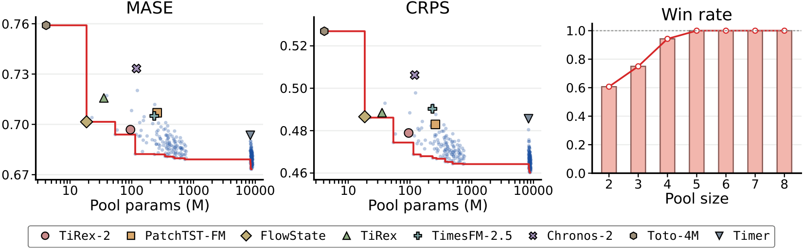

<div align="center">

# QUAL: Quantile Alignment Improves Zero-Shot Time-Series Foundation Models (FMTS@NeurIPS'26)

[](https://fmts-workshop.github.io/)
[](https://www.python.org/)
[](https://numpy.org/)

**Label-free · Training-free · Plug in any quantile forecaster**

</div>

> **TL;DR** Use the model pool as a probability reference, not only as an ensemble.
> Re-expressing each TSFM's quantiles on the pooled distribution improves every
> member, and keeping the aligned members separate makes the combined forecast
> robust to weak models.

## Overview

**QUAL** (**Qu**antile **al**ignment) is a simple, label-free framework for
improving and combining quantile forecasts from several time-series
foundation models (TSFMs). It needs **no training, no target labels, and no
change to the member models**: any model that outputs quantiles can be plugged in.

<p align="center">
  
</p>

<p align="left"><em>
<b>Figure 1.</b> Parameter efficiency and subset win rate on GIFT-Eval. MASE and CRPS
panels plot each pool against total parameter count; markers are single TSFMs,
red lines are Pareto frontiers. Win rate is the fraction of subsets that beat
the best individual model on both metrics.
</em></p>

## ✨ Highlights

- **The pool is a reference, not just an ensemble.** QUAL re-expresses each
  member forecast on the pooled distribution of all members. This alone improves
  every evaluated TSFM, reducing average member MASE and CRPS on GIFT-Eval by
  **7.4%** and **9.8%**.
- **Robust to weak members.** Because aligned members stay separate, a Huber
  aggregator can limit the influence of a forecaster that disagrees with the
  rest. When three weak forecasters join the pool, QUAL's CRPS degrades by
  **5.6%**, versus 11.9% for the linear opinion pool.
- **Beats the best single model.** On multi-model subsets of eight public TSFMs,
  QUAL beats the best individual model on both MASE and CRPS in **91.8%** of
  subsets with at least three members, and in every subset with at least five.

## 📊 Results

Every TSFM improves after quantile alignment, and the full QUAL forecast beats
every original member on both metrics.

| Model | MASE (original) | MASE (aligned) | CRPS (original) | CRPS (aligned) |
|---|:---:|:---:|:---:|:---:|
| TiRex-2 | 0.6969 | 0.6810 <sub>(−2.3%)</sub> | 0.4789 | 0.4704 <sub>(−1.8%)</sub> |
| PatchTST-FM | 0.7069 | 0.6835 <sub>(−3.3%)</sub> | 0.4829 | 0.4732 <sub>(−2.0%)</sub> |
| Timer-S1 | 0.6935 | 0.6783 <sub>(−2.2%)</sub> | 0.4856 | 0.4748 <sub>(−2.2%)</sub> |
| FlowState | 0.7015 | 0.6824 <sub>(−2.7%)</sub> | 0.4866 | 0.4738 <sub>(−2.6%)</sub> |
| TiRex | 0.7158 | 0.6838 <sub>(−4.5%)</sub> | 0.4885 | 0.4743 <sub>(−2.9%)</sub> |
| TimesFM-2.5 | 0.7050 | 0.6828 <sub>(−3.2%)</sub> | 0.4903 | 0.4753 <sub>(−3.1%)</sub> |
| Chronos-2 | 0.7333 | 0.6833 <sub>(−6.8%)</sub> | 0.5062 | 0.4774 <sub>(−5.7%)</sub> |
| Toto-2.0-4M | 0.7591 | 0.6859 <sub>(−9.6%)</sub> | 0.5269 | 0.4849 <sub>(−8.0%)</sub> |
| **QUAL (combined)** | | **0.6793** | | **0.4646** |

<sub>GIFT-Eval, 97 configurations. Scores are geometric means relative to the
seasonal-naive forecast; lower is better. "Aligned" is each member after
quantile alignment against the eight-model pool.</sub>

## ⚙️ How it works

Given $K$ member forecasts, each a vector of quantiles on the levels
$\tau_1 < \dots < \tau_Q$, QUAL proceeds in three steps for every horizon step.

1. **Quantile alignment.** Each member's quantiles define a piecewise-linear CDF
   $G_k$; their average $\bar G = \frac{1}{K}\sum_k G_k$ is the pooled CDF.
   Every reported value is relabelled by its pooled percentile
   $\bar G(q_k(\tau_j))$, and each member is read back at the requested levels.
2. **Huber aggregation.** The aligned members are combined level by level with a
   Huber robust center (threshold $c = 1.345$ on the MAD scale), which acts like
   an average near the consensus and downweights large disagreements.
3. **Rearrangement.** The combined quantiles are sorted so they never cross.

## 📦 Installation

```bash
pip install git+https://github.com/junhyeokkang/QUAL.git
```

The only dependency is NumPy.

## 🚀 Quick start

```python
import numpy as np
from qual import combine, align

# Quantile forecasts from your own models, each shaped (Q, T)
# for one forecast instance or (n, Q, T) for a batch.
forecasts = {
    "chronos-2": chronos_quantiles,
    "timesfm-2.5": timesfm_quantiles,
    "tirex": tirex_quantiles,
}

levels = np.arange(1, 10) / 10                  # quantile level of each row
combined = combine(forecasts, levels=levels)    # QUAL forecast: (Q, T) or (n, Q, T)
aligned = align(forecasts, levels=levels)       # aligned members: (K, Q, T) or (K, n, Q, T)
```

A runnable example with synthetic forecasts:

```bash
python examples/quickstart.py
```

<details>
<summary><b>API reference</b></summary>

<br>

| Function | Returns |
|---|---|
| `combine(forecasts, levels=None, threshold=1.345, num_iterations=2)` | The QUAL forecast after alignment, Huber aggregation and rearrangement. |
| `align(forecasts, levels=None)` | Each member forecast after quantile alignment, without aggregation. |

`forecasts` can be a dict or list of per-model arrays, or a stacked
`(K, Q, T)` / `(K, n, Q, T)` array. Quantile rows go from the lowest level to
the highest. `levels` defaults to `0.1, ..., 0.9` when there are nine rows.
The default `threshold` and `num_iterations` are the values used in the paper.

</details>

## 📝 Citation

If you find QUAL useful, please cite our paper:

```bibtex
@inproceedings{kang2026qual,
  title     = {{QUAL}: Quantile Alignment Improves Zero-Shot Time-Series Foundation Models},
  author    = {Kang, Junhyeok and Han, Sangjun and Seo, Jun and Lee, Seunghan and Lee, Jaehoon and Kang, Dongwan and Kim, Minjae and Yoo, Sungdong and Lim, Tae Yoon and Choi, Hwanil and Lee, Soonyoung and Ahn, Wonbin},
  booktitle = {NeurIPS 2026 Workshop on Foundation Models for Temporal Systems: From Forecasting to World Modeling},
  year      = {2026}
}
```
